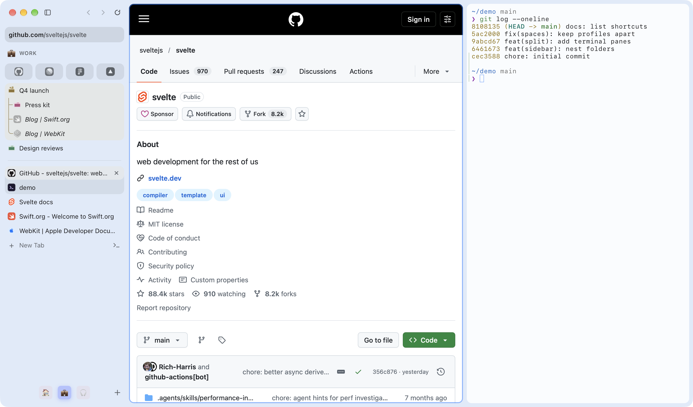

<div align="center">

# Lilo

**Le navigateur Mac à la Arc, sur WebKit et pas Chromium.**

Vos extensions Chrome, des onglets de terminal à côté de vos pages et un serveur MCP intégré pour vos agents IA. Gratuit, open source, sans compte.

[](https://github.com/Alexays/Lilo/releases/latest/download/Lilo.dmg)

`brew install --cask alexays/tap/lilo` · macOS 26 ou plus récent

[](https://github.com/Alexays/Lilo/releases/latest)
[](https://github.com/Alexays/Lilo/releases)
[](https://github.com/Alexays/Lilo/stargazers)
[](../../LICENSE)

[Site web](https://getlilo.app) ·
[Discord](https://discord.gg/NyJRAapk76) ·
[En venant d'Arc](#en-venant-darc) ·
[Documentation](../README.md) ·
[Contribuer](../../CONTRIBUTING.md)

<picture>
  <source media="(prefers-color-scheme: dark)" srcset="../assets/lilo-dark.png">
  
</picture>

<sub>[English](../../README.md) · **Français** · [Español](README_es.md) · [简体中文](README_zh-Hans.md) · [Português (Brasil)](README_pt-BR.md) · [Русский](README_ru.md) · [Українська](README_uk.md) · [Deutsch](README_de.md) · [日本語](README_ja.md) · [Italiano](README_it.md) · [한국어](README_ko.md) · [繁體中文](README_zh-Hant.md) · [Polski](README_pl.md) · [Türkçe](README_tr.md) · [Nederlands](README_nl.md)</sub>

</div>

Lilo est un navigateur Mac pour celles et ceux qui vivent dans une barre latérale. Ce n’est pas
un énième dérivé de Chromium : il est écrit en Swift et AppKit natifs, utilise le moteur WebKit
déjà présent dans macOS et fait tourner les extensions Chrome dont vous dépendez. Il place des
onglets de terminal à côté de vos pages et permet aux agents IA que vous utilisez déjà de le
piloter via un serveur MCP intégré, dans leur propre espace. Gratuit, sous licence MIT, sans
compte. Si vous quittez Arc, il importe vos espaces, onglets épinglés et dossiers en quelques clics.

> **Statut : bêta publique.** Lilo est utilisable au quotidien, mais reste en bêta : attendez-vous
> à quelques imperfections et à une interface qui évolue encore. Merci de
> [signaler les problèmes](https://github.com/Alexays/Lilo/issues).
> [ROADMAP.md](../../ROADMAP.md) présente les priorités et ce qui sort du périmètre du projet.

Rejoignez la [communauté Discord](https://discord.gg/NyJRAapk76) pour partager vos retours et obtenir de l’aide sur Lilo.

## En venant d'Arc

Arc s'arrête le 22 décembre 2026. Lilo garde sa façon de naviguer dans une barre latérale, et importe ce que vous avez dans Arc directement depuis votre Mac, sans rien y modifier :

- **Espaces, onglets et vues partagées** : chaque espace Arc devient un espace Lilo avec son icône et sa couleur, ses onglets épinglés et ouverts, ses dossiers et ses vues partagées. Les favoris deviennent des onglets en signet.
- **Historique et connexions** : vos pages récentes remplissent la barre de commande, et les cookies sont copiés pour que vous restiez connecté.
- **Extensions** : celles du Chrome Web Store se réinstallent depuis le store. Vous choisissez lesquelles.
- **Raccourcis** : partez du préréglage Arc, puis modifiez ceux que vous voulez.

Ce qui change, c'est le moteur : WebKit au lieu de Chromium. Avec les mêmes onglets, Chrome consomme environ 3 fois l'énergie de Lilo ([mesuré](../ENERGY.md)), et quelques API d'extensions Chrome diffèrent encore ([COMPATIBILITY.md](../../COMPATIBILITY.md)). [La page alternative à Arc](https://getlilo.app/fr/arc-alternative/) compare les deux, fonction par fonction.

## Pourquoi Lilo

La plupart des alternatives à Arc sont Chromium avec une nouvelle barre latérale. Lilo garde la
barre latérale et change le reste.

- **Sans Chromium.** Aucun moteur de navigateur embarqué, aucun Electron : Swift, AppKit et le
  WebKit du système, avec la barre latérale et les réglages en Svelte. Moins de mémoire utilisée,
  une batterie qui tient la journée et les mises à jour de sécurité d’Apple à chaque version de macOS.
- **Privé par défaut.** Aucun compte, aucune télémétrie, aucune analyse d’usage, aucun serveur :
  rien de ce que vous faites n’est envoyé au projet. Les publicités et les traqueurs sont bloqués
  dès l’installation, le suivi entre sites est bloqué comme dans Safari, et Global Privacy Control
  est activé (macOS 27). Chaque requête que Lilo effectue de lui-même est
  [répertoriée, avec la façon de la désactiver](../../PRIVACY.md#requests-lilo-makes-on-its-own).
- **Les extensions Chrome, quand même.** Quitter Chromium signifie souvent abandonner ses
  extensions. Dans Lilo, les extensions du Chrome Web Store s’installent d’un clic sur « Ajouter
  à Lilo », via le moteur d’extensions natif de WebKit ([COMPATIBILITY.md](../../COMPATIBILITY.md)).
- **Vos agents le pilotent, il n’intègre pas sa propre IA.** Aucun chatbot ajouté : les agents que
  vous utilisez déjà (Claude Code, Codex, Cursor ou tout client MCP) accèdent à un vrai navigateur
  grâce au serveur MCP intégré, dans leur propre espace et un profil temporaire. Ils vous demandent
  votre accord avant d’envoyer, de payer ou de supprimer.
- **Un terminal à côté de vos pages.** Les onglets de terminal basés sur Ghostty vivent dans la
  barre latérale avec vos sites et affichent la branche et les modifications en attente de leur dépôt.
- **À vous.** Sous licence MIT. Toute l’interface est une couche Svelte sur WebKit que vous pouvez
  modifier et recompiler en quelques secondes.

## Fonctionnalités

**Navigation**

- **Espaces et profils** : des espaces avec un emoji et une couleur, chacun connecté à son propre
  profil ; passez de l’un à l’autre par un balayage. Les espaces privés oublient tout à leur fermeture.
- **Barre latérale** : onglets épinglés, favoris, dossiers imbriqués jusqu’à cinq niveaux
  (verrouillables), réorganisation par glisser-déposer, commandes audio et de lecture en cours.
- **Barre de commandes** (`Cmd+T`) : onglets, historique, signets, espaces et toutes les actions
  dans un seul champ, classés selon votre usage.
- **Onglets récents** (`Ctrl+Tab`) : parcourez les derniers onglets de tous vos espaces dans
  l’ordre où vous les avez utilisés.
- **Peek** : un lien d’un onglet épinglé vers un autre site, ou tout lien ouvert avec `Maj`+clic,
  s’affiche au-dessus de la page.
- **Petite fenêtre** (`Cmd+Option+N`, depuis n’importe quelle app) : une petite fenêtre pour un
  lien ou une recherche, à envoyer vers un espace lorsque vous souhaitez poursuivre.
- **Des onglets qui se rangent seuls** : les onglets non épinglés que vous n’utilisez plus sont
  archivés après un délai choisi pour chaque espace ; `Cmd+Shift+K` les efface, et les archives
  restent à un raccourci clavier.
- **Règles de liens** : les liens ouverts depuis d’autres apps vont vers l’espace ou la petite
  fenêtre qu’une règle choisit.
- **Vue fractionnée** : jusqu’à quatre onglets côte à côte, restaurés au prochain lancement.
- **Raccourcis** : tous les raccourcis sont personnalisables, à partir des préréglages Lilo ou Arc.
- **Importation** : signets, onglets ouverts et espaces, historique, cookies et extensions de
  Safari, Firefox, Zen et des navigateurs Chromium (Chrome, Arc, Brave, Edge, Vivaldi, Opera, Dia,
  Comet, Chromium), lus directement sur votre Mac.

**Extensions et web**

- **Extensions Chrome** : Manifest V3 via le moteur d’extensions natif de WebKit, complété par de
  petits gestionnaires Swift pour les API manquantes ([COMPATIBILITY.md](../../COMPATIBILITY.md)).
- **Gestionnaires de mots de passe** : la configuration propose celui que vous utilisez
  (1Password, Bitwarden, Dashlane, KeePassXC, NordPass, Proton Pass).
- **Streaming** : vidéo et musique protégées via FairPlay ; YouTube en 4K HDR.
- **Blocage de contenu** : listes EasyList, EasyPrivacy et uBlock Origin mises à jour, avec
  filtrage cosmétique et scriptlets.
- **Captures d’écran** : la capture flotte dans une carte au-dessus de la page, prête à être
  annotée, enregistrée ou fermée.
- **Et aussi** : mode lecture, Image dans l’image (les appels flottent dans un panneau toujours
  au premier plan), traduction de pages, Web Serial, AppleScript, actions Raccourcis et filtre
  de concentration.

**Pour les personnes qui développent**

- **Onglets de terminal** : terminaux libghostty-vt avec un rendu Metal, à côté de vos pages
  (`Cmd+D` à côté, `Cmd+Shift+D` en dessous), avec la branche et les modifications en attente
  dans la barre latérale.
- **Vue des modifications** : tous les écarts du dépôt, images comprises.
- **Éveillé pendant le travail** : une commande longue garde le Mac éveillé, même avec le capot
  fermé, puis le laisse se mettre en veille.
- **Agents via MCP** : le serveur MCP intégré, voir [Pour les agents IA](#pour-les-agents-ia).

## Pour les agents IA

Lilo intègre un serveur MCP. Activez-le : les agents que vous utilisez déjà (Claude Code, Claude
Desktop, Codex, Cursor ou tout client MCP) pilotent un vrai navigateur WebKit à vos côtés. Lilo
n’embarque pas sa propre IA.

- **Leur propre espace.** Les agents ouvrent leurs onglets dans un dossier de l’espace Agents,
  dans un profil temporaire effacé après chaque session. Ils ne prennent jamais votre clavier,
  votre souris ni vos onglets, et ne voient jamais un espace privé. Un agent peut emprunter l’un
  de vos profils après votre autorisation.
- **Vous donnez d’abord votre accord.** Lilo demande votre autorisation avant qu’un agent envoie,
  paie, supprime ou publie (autoriser une fois, toujours autoriser sur le site ou refuser), ainsi
  qu’avant de transmettre l’un de vos fichiers à une page. Chaque client est approuvé une seule
  fois, en fonction du programme qui l’exécute plutôt que du nom qu’il déclare.
- **Connexion en un clic.** Dans Réglages > Agents IA, activez « Laisser les agents IA utiliser
  Lilo », puis cliquez sur « Connecter » à côté de Claude Code, Claude Desktop, Codex ou
  Cursor : Lilo s’ajoute aux serveurs MCP de ce client. Pour les autres clients, copiez la
  configuration depuis « Autres agents ».

Demandez ensuite à votre agent, par exemple :

```text
Ouvre localhost:3000/checkout dans Lilo, paie avec la carte de test et trouve pourquoi la commande échoue.
Vérifie la console et le réseau.
```

Les outils couvrent :

- **Onglets et navigation** dans le dossier de l’agent, ainsi que des onglets isolés qui ne
  partagent ni cookies ni connexions.
- **Saisie** : clics, texte, touches, défilement, glisser-déposer, formulaires, envoi de fichiers
  et d’images.
- **Lecture des pages** : arbre d’accessibilité avec références d’éléments, recherche de texte,
  texte de la page.
- **Captures d’écran** d’une page entière ou d’un élément, et enregistrements GIF.
- **Console et réseau** : messages, requêtes et réponses complètes, export HAR, cookies.
- **Simulation du réseau et émulation** : requêtes simulées, échouées ou retardées ; agent
  utilisateur, thème de couleurs, réduction des animations, média d’impression, en-têtes
  supplémentaires, scripts d’initialisation ; taille de la zone d’affichage.
- **Performances** : mesures de chargement et d’affichage, mémoire et profils chronologiques.
- **Inspecteur web** : le protocole d’inspection de WebKit, ses commandes et ses événements.
- **Scripts** : JavaScript dans la page, `fetch` depuis un onglet avec ses cookies, et `run` ou
  `browser_batch` pour enchaîner plusieurs appels en un seul aller-retour.
- **Profils** : les lister, en emprunter un avec votre autorisation ou réinitialiser le profil
  temporaire.

[docs/AI-AGENTS.md](../AI-AGENTS.md) détaille les autorisations demandées, celles qui ne le sont
pas et les erreurs qui nécessitent votre intervention.

## Installation

Au choix :

- téléchargez le DMG depuis les [versions publiées](https://github.com/Alexays/Lilo/releases/latest), ou
- installez avec Homebrew :

  ```bash
  brew install --cask alexays/tap/lilo
  ```

Lilo se met à jour automatiquement grâce aux mises à jour signées de Sparkle.

### Prérequis

- macOS 26 ou version ultérieure. Global Privacy Control nécessite macOS 27.

## Compiler depuis les sources

Avec Xcode 27 et Node.js 22.6+ installés ([prérequis complets](../../CONTRIBUTING.md#requirements)) :

```bash
git clone https://github.com/Alexays/Lilo.git && cd Lilo
make bootstrap                  # checks the prerequisites and fetches or builds what the app needs
make install                    # Release build into /Applications, replacing an installed copy
open /Applications/Lilo.app
```

`make bootstrap` indique ce qui manque et comment l’installer. Pour travailler uniquement sur
l’interface, Node.js suffit : `make ui-preview` l’ouvre dans votre navigateur avec rechargement
à chaud ([CONTRIBUTING.md](../../CONTRIBUTING.md#interface-only)).

Aucun compte Apple Developer n’est nécessaire. Les compilations depuis les sources sont signées
de manière ad hoc par défaut ; [CONTRIBUTING.md](../../CONTRIBUTING.md#signing) explique les
compromis et la signature avec un identifiant Apple gratuit.

## Documentation

- [docs/](../README.md) : architecture, débogage, traduction, publication, agents IA
- [COMPATIBILITY.md](../../COMPATIBILITY.md) : les différences restantes avec Chrome pour les extensions et les sites
- [PRIVACY.md](../../PRIVACY.md) : chaque requête que Lilo effectue de lui-même
- [ROADMAP.md](../../ROADMAP.md) : ce qui est disponible, ce qui arrive et ce qui sort du périmètre

## Contribuer

Les pull requests sont les bienvenues. [CONTRIBUTING.md](../../CONTRIBUTING.md) couvre la mise en
place, le processus de développement et les vérifications avant une pull request. Posez vos
questions dans les [discussions](https://github.com/Alexays/Lilo/discussions)
([SUPPORT.md](../../SUPPORT.md)) et signalez les vulnérabilités en privé
([SECURITY.md](../../SECURITY.md)). Toute personne participant au projet suit le
[code de conduite](../../CODE_OF_CONDUCT.md).

## Licence

MIT, voir [LICENSE](../../LICENSE). Les composants tiers inclus sont répertoriés dans
[THIRD-PARTY-NOTICES.md](../../THIRD-PARTY-NOTICES.md).
